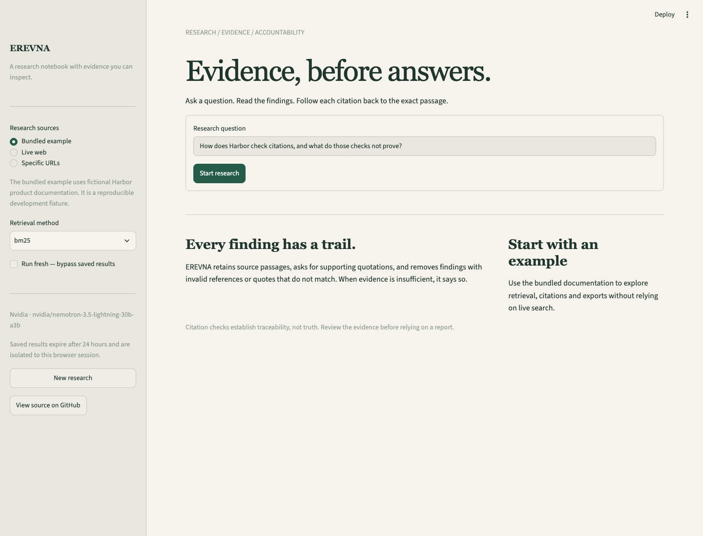
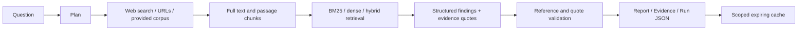

# EREVNA

**Evidence-backed research with inspectable passages, citations and run metrics.**

Ask a question, retrieve relevant passages, generate findings with supporting quotes,
and inspect the evidence behind each finding. Runs through a Streamlit app or REST API.



## What works

- NVIDIA NIM generation, with explicit provider selection; OpenAI, Ollama and extractive demo adapters.
- Live web search, specific public URLs, or a bundled fictional documentation corpus.
- Full-page collection, overlapping passage chunks and BM25 retrieval. Optional dense and hybrid retrieval.
- Structured findings with passage IDs and supporting quotes. Invalid references/non-matching quotes are removed.
- Explicit insufficient-evidence responses, including when no relevant passages are found.
- Source/evidence inspection, Markdown reports and complete JSON run exports.
- Per-stage latency, provider/model metadata and reported token usage. Cost is unknown unless pricing is configured.
- Session-scoped SQLite cache with 24-hour freshness and retained evidence.
- API input limits, bearer authentication, concurrency bounds and private-network fetch protection.
- Offline development evaluation, unit/integration/UI tests and CI.

**Status:** working local portfolio prototype. Not a deployed multi-user production service.
Citation checks establish traceability; they do **not** independently prove claim support or truth.

## Run locally

Python **3.12** is the tested runtime.

```sh
git clone https://github.com/ramshetty01/EREVNA.git
cd EREVNA
python3.12 -m venv .venv
. .venv/bin/activate
pip install -r requirements.lock
cp .env.example .env
streamlit run app.py --server.address=127.0.0.1
```

Open http://localhost:8501. The default configuration is an extractive demo with no
model calls. Choose **Bundled example** to run without live search or a downloaded model.
It uses fictional Harbor product docs, clearly labelled in the interface.

For NVIDIA, edit the ignored `.env` locally:

```dotenv
LLM_PROVIDER=nvidia
NVIDIA_API_KEY=<your-own-key>
NVIDIA_MODEL=nvidia/nemotron-3.5-lightning-30b-a3b
```

NVIDIA's hosted catalogue changes. The model above was tested during this implementation;
choose an available model if it is later retired. The NVIDIA adapter sends credentials only
to `https://integrate.api.nvidia.com/v1`. `.env` is excluded from Git and Docker builds.
Never put keys into issues, README examples, screenshots or commits.

For Ollama, set `LLM_PROVIDER=ollama` and `OLLAMA_MODEL` to a model you have installed.
For OpenAI, set `LLM_PROVIDER=openai` and `OPENAI_API_KEY`. These adapters are implemented;
the recorded live checks in this release used NVIDIA.

## Research flow



Live web research uses up to two search queries and six source pages. Fetches are bounded,
redirects revalidated, and connections pinned to validated public IPs. Provided-document
research uses a deterministic plan and one generation call, plus at most one citation-repair attempt if quote checks fail. Each structured call allows one format retry.
No report-writing stage is allowed to silently introduce new uncited prose.

### Retrieval modes

BM25 is available in the default installation, with no model download.

```sh
pip install -r requirements-semantic.txt
python -m research.evaluate --method dense --output artifacts/dense-evaluation.json
python -m research.evaluate --method hybrid --output artifacts/hybrid-evaluation.json
```

Dense retrieval uses `sentence-transformers/all-MiniLM-L6-v2`; hybrid uses reciprocal-rank
fusion. Installation and first use download the model. Ranking/fusion contracts are tested
with fixed embeddings; the committed numerical results cover BM25 only, not dense/hybrid.

## Evaluation — scope matters

```sh
make evaluate PYTHON=.venv/bin/python
# Explicitly calls the configured provider on three cases:
make live-evaluate PYTHON=.venv/bin/python
```

The development set has **50 authored cases over fictional docs**: 40 answerable and
10 unanswerable. It deliberately includes long navigation prefixes to test the previous
500-character truncation. It is not a held-out benchmark or an estimate of real-world accuracy.

| Retrieval | Source recall@3 | Mean reciprocal rank |
|---|---:|---:|
| First 500 characters + BM25 | 0.55 | 0.5333 |
| Full passages + BM25 | 1.00 | 0.9875 |

These metrics measure source retrieval, **not answer correctness**. Three recorded NVIDIA
cases passed the expected abstention decisions, including one unanswerable question.
Small-sample checks do not establish a hallucination rate. See [evaluation methodology](docs/evaluation.md)
and [recorded results](docs/evaluation-results.json).

## API

```sh
# Local machine only. Do not use this setting on a public bind address.
EREVNA_API_LOCAL=1 .venv/bin/python -m uvicorn research.api:app --host 127.0.0.1 --port 8000
```

Health: `GET /health`. Interactive API schema: http://localhost:8000/docs.
For shared deployments set `EREVNA_API_TOKEN` and send `Authorization: Bearer <token>`.
Without a token or explicit local mode, `/research` rejects requests.

```sh
curl http://localhost:8000/research \
  -H 'Content-Type: application/json' \
  -d '{"query":"When does the cache expire?","documents":[{"title":"Cache policy","url":"https://example.org/cache","text":"Cache entries expire after 24 hours."}],"retrieval":"bm25"}'
```

Omit `documents` to use live web search. An empty documents array means an empty corpus
and produces an insufficient-evidence result. Responses contain findings, passages, sources,
plan, warnings and metrics. Limits: 1,500 question characters, 12 documents, 300,000 total
source characters, 400 KB request body, two concurrent research requests per API process.

## Verification

```sh
make lint typecheck test evaluate smoke PYTHON=.venv/bin/python
make security PYTHON=.venv/bin/python
```

Tests use isolated credentials and mocked model calls; they do not spend API credits.
The browser test script in `scripts/browser_check.py` is an explicit optional live smoke test.
Install Playwright separately before running it. Screenshots are in `docs/images`.

## Files

- `research/pipeline.py`: shared orchestration and usage metrics
- `research/models.py`: validated source, passage, answer and run contracts
- `research/retrieval.py`: chunking, BM25, dense and hybrid search
- `research/citations.py`: reference/quote checks and deterministic rendering
- `research/api.py`: REST endpoints and request controls
- `research/evaluate.py`: offline evaluation and explicit bounded live checks
- `agents/memory_agent.py`: scoped, expiring report cache
- `tools/web_search.py`: search and bounded public-page fetching
- `app.py`: Streamlit presentation
- `data/development_set.json`: authored regression fixture

## Limits and next steps

- Semantic claim support is not independently checked. A real quote can still be used to support an invalid inference.
- Web search can be blocked or rate-limited. Failed scrapes fall back to labelled snippets; PDF/JS-only pages are not parsed.
- Prompt-injection instructions are treated as untrusted data, but this is not a guarantee of model compliance.
- The browser uses a new session namespace on reload; it is not an account/authentication system.
- Multi-user deployment needs authentication, per-user quotas, external persistence and an enforced network egress policy.
- Dense/hybrid quality, public deployment, larger human-reviewed evaluation and production load testing remain future work.
- The old individual analyst/report helpers remain for compatibility; the app and API use `research.pipeline`.

[Deployment notes](docs/deployment.md) · [Security](SECURITY.md) · [Changelog](CHANGELOG.md)
