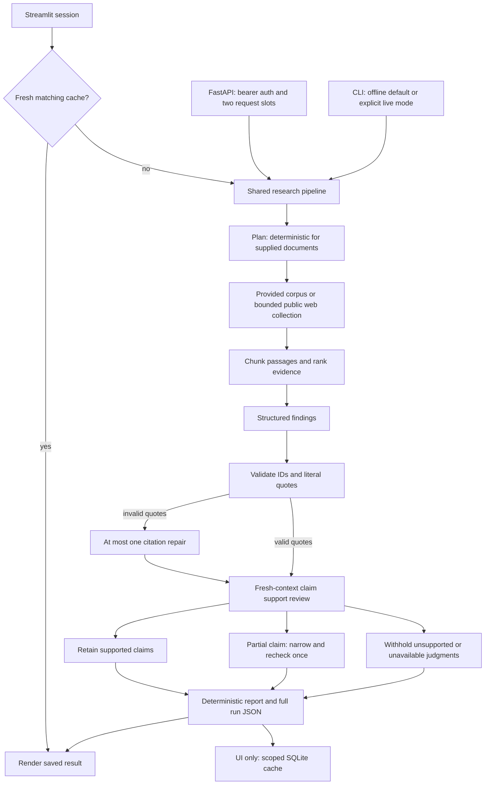
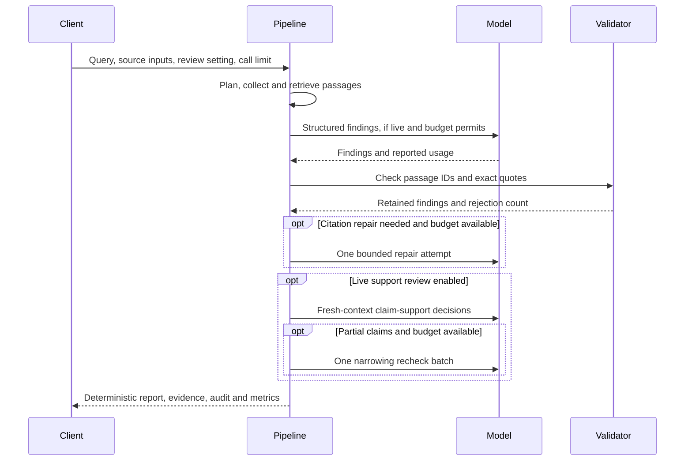
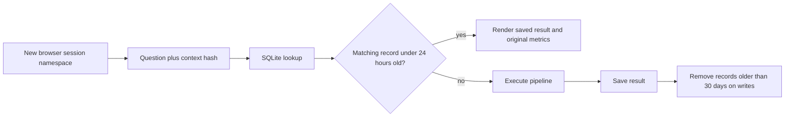
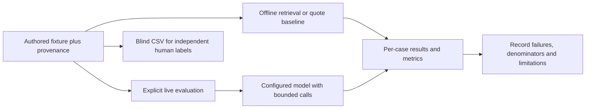
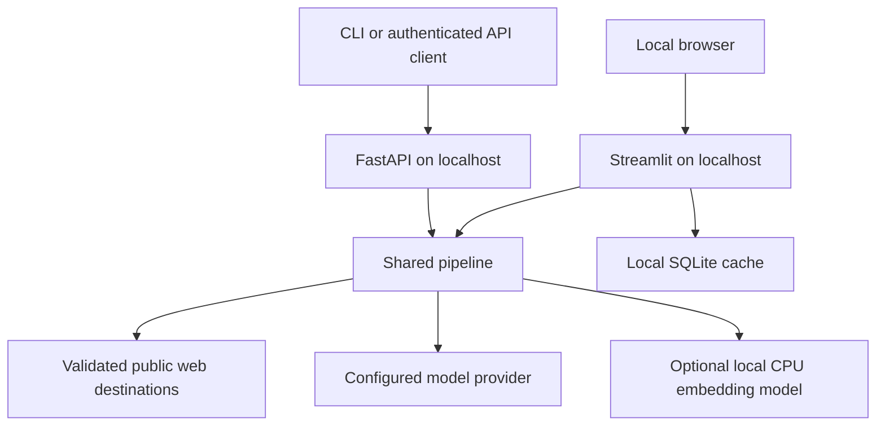

# Workflow architecture

Streamlit, FastAPI and the command-line entrypoint share `research.pipeline.run_research`.
The pipeline returns a typed `ResearchResult`; presentation code does not rewrite claims.

Every active model stage passes through `research.llm_io.invoke` with the same run
metrics and call ceiling. It checks the limit before invoking the provider. JSON
parsing permits one retry within that ceiling. Failure before generation surfaces a
safe error; failure during verification withholds affected claims. No background
agent, recursive planning loop or unbounded repair loop runs behind this workflow.
Demo mode extracts source text and labels semantic review as skipped.

The UI alone uses the SQLite cache. API and CLI runs execute directly. The cache
context includes session, pipeline version, source inputs, provider/model, retrieval,
review setting and call limit. Cache hits reuse the original run's metrics, not new
provider usage. Reloading a browser creates a new session namespace.

Public web fetching validates destination IPs, pins connections and revalidates
redirects. Prompt text remains untrusted even after network checks. Exact quotation
matching establishes traceability; model support judgments remain fallible and do
not independently establish truth. The support audit preserves excluded claims and
reasons so a reviewer can inspect failures.

The API semaphore and call ceilings are local process/run controls. They do not
provide account identity, per-user daily quotas, distributed concurrency limits or
a whole-run cancellation deadline. See [roadmap](roadmap.md) for remaining work.

Retrieval now uses a corpus-local index that precomputes lexical statistics and, for
dense/hybrid modes, passage vectors. Evaluation reuses it across questions. A normal
research run creates its own index; document vectors are not cached across sessions.
Only the fixed CPU embedding model is reused across requests, with synchronized first
load and a pinned revision. No document content is passed to a hosted embedding API.

## Runtime sequence

## Cache lifecycle

## Evaluation flow

## Current deployment topology

Docker packages the app, but this diagram describes the tested local topology. A
public deployment still needs TLS, identity/authorization, shared quotas/persistence,
retention/deletion, network egress controls and deployed load testing.
